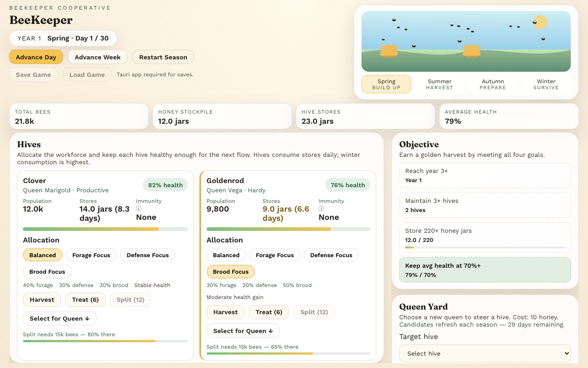

# BeeKeeper

A cozy strategy sim about managing hives across seasons. Balance forage, defense, and brood, keep queens thriving, and survive threats.

Built with React, TypeScript, and Vite, and packaged as a desktop app with [Tauri 2](https://tauri.app).



## Prerequisites

- [Node.js](https://nodejs.org) 20.19+ (or 22.12+)
- [pnpm](https://pnpm.io) — the pinned version is in `package.json`. Run `corepack enable` to use it automatically.
- For the desktop app: [Rust](https://www.rust-lang.org/tools/install) 1.90+ and the [Tauri system dependencies](https://tauri.app/start/prerequisites/) for your OS

## Getting started

```bash
pnpm install
pnpm dev
```

The web build runs in the browser at http://localhost:5173. Saving and loading are only available in the desktop app.

## Desktop (Tauri)

```bash
pnpm tauri:dev     # run the desktop app with hot reload
pnpm tauri:build   # build a release bundle for your platform
```

Save files are written to `beekeeper/save.json` inside the app's data directory (for example `~/Library/Application Support/com.beardedunicorn.beekeeper/` on macOS).

## Android

Tauri 2 supports Android. You will need Android Studio, the Android SDK, and the Rust Android targets installed — see the [Tauri prerequisites](https://tauri.app/start/prerequisites/).

```bash
pnpm android:init   # first run only, after the SDK is installed
pnpm android:dev
pnpm android:build
```

## Testing

```bash
pnpm test:run   # run the test suite once
pnpm lint
```

## Gameplay

- Advance a day or a week to simulate season changes.
- Allocate each hive to forage, defense, or brood.
- Harvest hive stores into your stockpile (small harvesting loss).
- Treat hives to improve health and reduce threat risk.
- Split strong hives to expand your apiary.
- Requeen to change trait bonuses.
- Save and load progress (desktop app only).

### Rules

- Seasons last 30 days and cycle through Spring, Summer, Autumn, and Winter.
- Queen traits alter honey, brood, defense, and threat chances.
- Hives consume stores daily, and winter consumption is highest.
- Harvesting is not perfectly efficient (you lose a small portion when extracting).
- If a hive drops too low in population or health, it collapses.
- Win condition: reach year 3+, maintain 3+ hives, store 220+ honey jars, and keep average health at 70%+.
- Difficulty ramps up each year (threats intensify and survival gets tougher).

## License

[MIT](LICENSE) © Mike Herold
